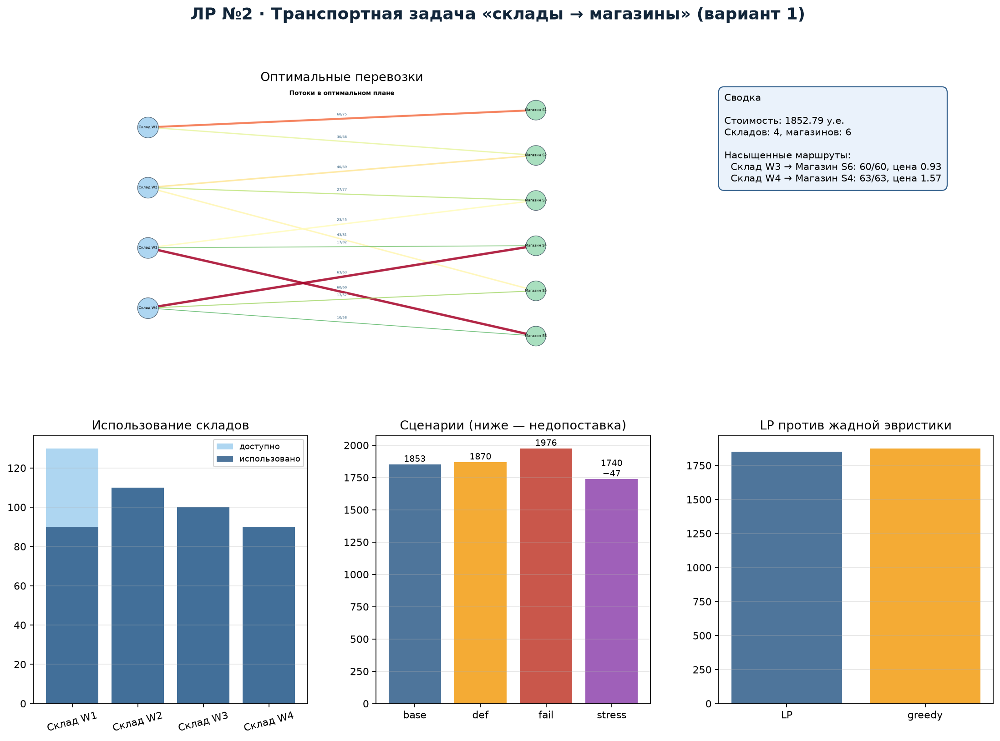
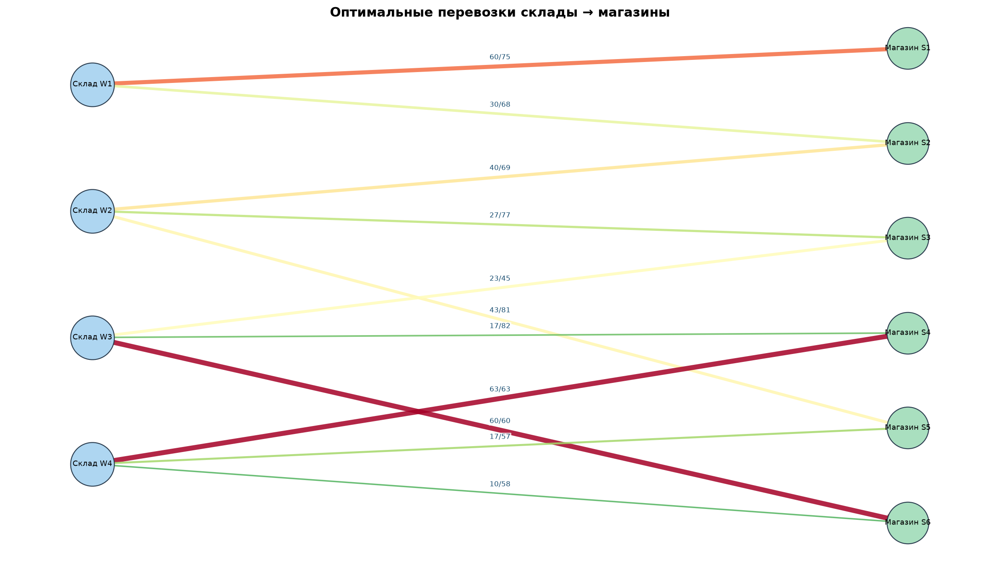
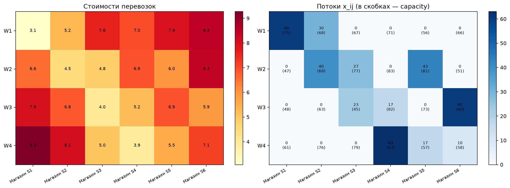
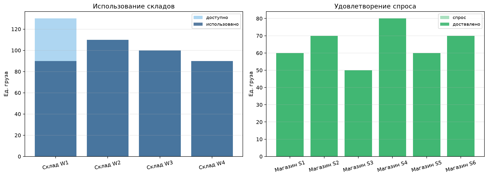

# Лабораторная работа №2
## Транспортная задача: склады → магазины


**Студент:** Якимов Максим Андреевич  
**Группа:** Б24-517, № 31  
**Вариант:** 1  
**Дисциплина:** «Методы оптимизации. Линейное программирование»
**Репозиторий:** <https://github.com/yakimak/OptLab_2>

---

## Дашборд



## Сеть



4 склада, 6 магазинов. Суммарный запас 430 ед., спрос 390 ед.
Стоимости и пропускные способности — `data/routes.csv`, seed `10131`.

## Модель

$$\min \sum_{i=1}^{4}\sum_{j=1}^{6} c_{ij}x_{ij}$$

при ограничениях

$$\sum_j x_{ij}\le s_i,\qquad \sum_i x_{ij}=d_j,\qquad
0\le x_{ij}\le u_{ij}.$$

## Результат

Минимальная стоимость — **1852.79 у.е.**; независимая проверка на NumPy
показала нулевое нарушение балансов и границ.

Насыщенные маршруты и теневые цены:

| Маршрут | Поток / capacity | Теневая цена |
|---|---:|---:|
| W3 → S6 | 60 / 60 | 0.93 |
| W4 → S4 | 63 / 63 | 1.57 |

Теневые цены запасов: W1 — 0, W2 — 0.78, W3 — 1.60, W4 — 1.29.

## Сценарии

| Сценарий | Стоимость | Недопоставка |
|---|---:|---:|
| Базовый | 1852.79 | 0 |
| Дефицит W2 −20 % | 1869.95 | 0 |
| Отказ W4 → S4 | 1976.08 | 0 |
| Стресс: W1/W2 −20 %, спрос +10 % | 1739.52 | 47 |

Жадная эвристика: 1875.99 (зазор 1.25 %). MILP-версия: 1852.79,
интегральный зазор 0 % (матрица транспортной задачи вполне унимодулярна).

## Графики

| Матрица стоимостей и потоков | Балансы |
|---|---|
|  |  |

## Запуск

```bash
pip install -r requirements.txt
python generate_data.py
python main.py
```

Выход: `results/lab2_flows.csv`, `lab2_balance.csv`, `lab2_scenarios.csv`,
`lab2_bottlenecks.csv`, `lab2_greedy.csv`, `lab2_milp.csv`, `solver.log`.

## Состав сдаваемых материалов

| Требование ТЗ | Файл |
|---|---|
| Исходный код | `main.py`, `generate_data.py` |
| README с установкой и запуском | `README.md` |
| Отчёт PDF / Markdown | `report.pdf`, `report.md` |
| Данные варианта и описание генерации | `data/warehouses.csv`, `data/stores.csv`, `data/routes.csv`, `data/README.md` |
| Лог солвера | `results/solver.log` |
| Таблица найденного решения | `results/lab2_flows.csv` |
| Независимая проверка | `results/verification.csv` |
| Сценарные эксперименты | `results/lab2_scenarios.csv` |
| Графики и схемы | `results/lab2_dashboard.png`, `lab2_network.png`, `lab2_matrix.png`, `lab2_balance.png`, `lab2_scenarios.png`, `lab2_greedy.png` |

## Отчёт

Готовый PDF: [`report.pdf`](report.pdf). Исходник: [`report.md`](report.md).
