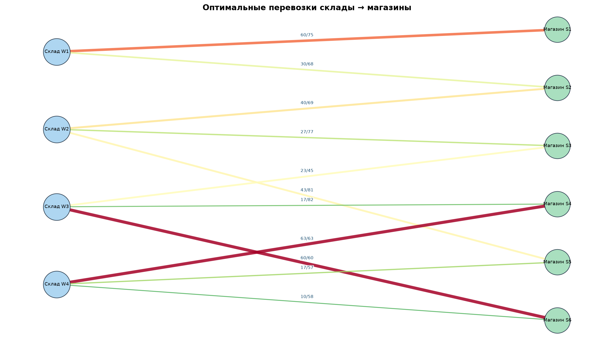
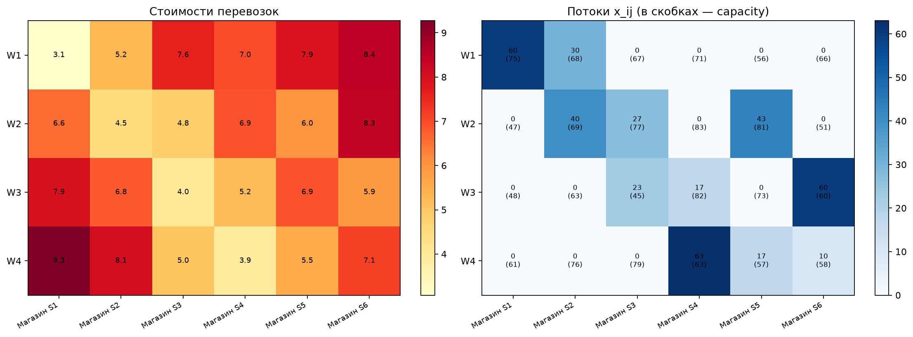
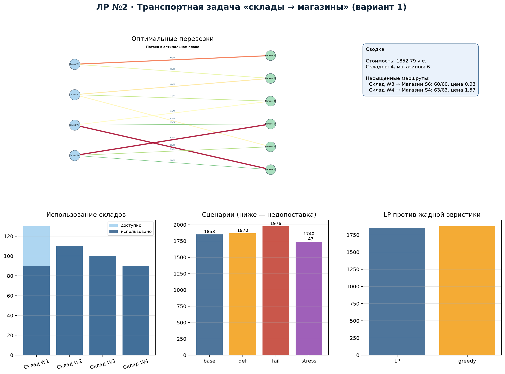

# 1. Постановка задачи и вариант

**Вариант:** 1 — транспортная задача «склады → магазины», минимум стоимости
перевозок. Минимальный масштаб: 4 склада, 6 магазинов.

Требуется определить объём перевозок с каждого склада в каждый магазин так,
чтобы удовлетворить спрос при ограничениях на запасы складов и пропускные
способности маршрутов, минимизируя суммарную стоимость.

# 2. Формальная модель

**Множества:** склады $i\in W=\{1,\ldots,4\}$; магазины $j\in S=\{1,\ldots,6\}$.

**Параметры:**

| Обозначение | Смысл | Единица |
|---|---|---|
| $s_i$ | запас склада $i$ | ед. |
| $d_j$ | спрос магазина $j$ | ед. |
| $c_{ij}$ | стоимость перевозки единицы | у.е./ед. |
| $u_{ij}$ | пропускная способность маршрута | ед. |

**Переменные:** $x_{ij}\ge 0$ — поток груза со склада $i$ в магазин $j$.

**Целевая функция:**
$$\min \sum_{i\in W}\sum_{j\in S} c_{ij}x_{ij}.$$

**Ограничения:**
$$\sum_{j} x_{ij}\le s_i,\qquad
\sum_{i} x_{ij}=d_j,\qquad
0\le x_{ij}\le u_{ij}.$$

Данные: seed $=10131$; суммарный запас 430 ед. превышает суммарный спрос
390 ед., поэтому задача сбалансирована по спросу, но имеет запас предложения.
Стоимости и пропускные способности хранятся в `data/routes.csv`.

# 3. Решение и проверка

Задача решена HiGHS через `scipy.optimize.linprog`:
`method="highs"`, двойственный симплекс, presolve включён, допуск $10^{-7}$.
Лог солвера сохранён в `results/solver.log`, статус — `Optimal`.
Минимальная стоимость — **1852.79 у.е.** Независимая проверка на NumPy
подтвердила баланс в каждом магазине, непревышение запасов и пропускных
способностей; построчные результаты сохранены в
`results/verification.csv`, максимальное нарушение $0.0$.

**Основные потоки:**

| Маршрут | Поток / capacity |
|---|---:|
| W1 → S1 | 60 / 75 |
| W1 → S2 | 30 / 68 |
| W2 → S2 | 40 / 69 |
| W2 → S3 | 27 / 77 |
| W2 → S5 | 43 / 81 |
| W3 → S3 | 23 / 45 |
| W3 → S4 | 17 / 82 |
| W3 → S6 | 60 / 60 |
| W4 → S4 | 63 / 63 |
| W4 → S5 | 17 / 57 |
| W4 → S6 | 10 / 58 |

Использование складов: W1 — 90 из 130, W2 — 110 из 110, W3 — 100 из 100,
W4 — 90 из 90. Склады W2–W4 используются полностью, W1 имеет запас 40 ед.

# 4. Теневые цены и узкие места

| Ограничение | Двойственная оценка | Конечная разность |
|---|---:|---:|
| Запас W1 | 0.00 | 0.00 |
| Запас W2 | 0.78 | 0.78 |
| Запас W3 | 1.60 | 1.60 |
| Запас W4 | 1.29 | 1.29 |

Насыщенные маршруты:

- W3 → S6: 60/60, теневая цена 0.93;
- W4 → S4: 63/63, теневая цена 1.57.

Дополнительная единица пропускной способности W4 → S4 снижает стоимость на
1.57 у.е., W3 → S6 — на 0.93. Дополнительная единица запаса W3 экономит
1.60 у.е.; запас W1 не является дефицитным (теневая цена 0). Это указывает,
что в первую очередь нужно расширять W3 и маршрут W4 → S4.

# 5. Сценарии

| Сценарий | Статус | Стоимость | Недопоставка |
|---|---|---:|---:|
| Базовый | optimal | 1852.79 | 0 |
| Дефицит W2 −20 % | optimal | 1869.95 | 0 |
| Отказ маршрута W4 → S4 | optimal | 1976.08 | 0 |
| Стресс: W1, W2 −20 %, спрос +10 % | optimal с потерянными продажами | 1739.52 | 47 |

- **Дефицит W2.** Запас W2 снижается со 110 до 88; план перестраивается,
  стоимость растёт на 17.16 у.е. (0.9 %). Дефицит компенсируется другими
  складами.
- **Отказ W4 → S4.** Закрытие самого загруженного маршрута (63 ед.) повышает
  стоимость до 1976.08 (+123.29, 6.7 %). Сеть остаётся связной, но теряет
  дешёвый маршрут.
- **Стресс.** После снижения запасов W1 и W2 и роста спроса на 10 % суммарного
  предложения не хватает; модель с потерянными продажами доставляет 429−47
  единиц. Минимальная недопоставка — 47 ед., что совпадает с разностью
  спроса и доступного предложения.

# 6. Сравнение с жадной эвристикой и MILP

Жадная эвристика «сначала самые дешёвые маршруты» даёт стоимость 1875.99,
что на 1.25 % выше оптимума. Она быстро строит допустимый план, но не
учитывает глобальную структуру ограничений и может оставить более дорогие
маршруты для части спроса.

Целочисленная MILP-версия (неделимые единицы груза) даёт ту же стоимость
1852.79: матрица транспортной задачи вполне унимодулярна, поэтому LP-оптимум
уже целочисленный. Интегральный зазор — 0 %.

# 7. Практическая реализуемость и ограничения модели

Оптимальный план можно реализовать на практике при наличии фактических
запасов и пропускных способностей, близких к расчётным. Основные ограничения:

- модель линейна и не учитывает неделимость рейсов; в данной задаче LP-решение
  целочисленное, но при других данных потребуется MILP;
- стоимости считаются постоянными и не зависят от объёма партии;
- не учитываются динамика спроса внутри периода и случайные задержки;
- пропускные способности заданы детерминированно, без вероятностей отказов.

Для промышленного применения модель стоит дополнить временными окнами,
целочисленными рейсами и стохастическими сценариями спроса.

# 8. Вывод

Оптимальный план полностью удовлетворяет спрос при стоимости 1852.79 у.е.
Узкие места — запас W3 и маршруты W3 → S6 и W4 → S4. Сценарии показывают,
что сеть устойчива к отказу одного маршрута и снижению запаса W2, но
одновременное сокращение двух складов и рост спроса на 10 % приводит к
дефициту 47 ед. Практическое ограничение модели — непрерывность потока;
для неделимых рейсов нужна MILP, но в данной задаче LP-решение уже
целочисленное.
